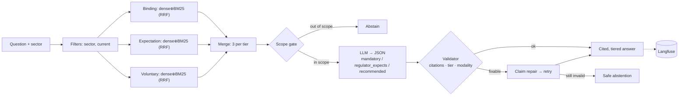

# AU AI Regulation Navigator

**Tier-aware RAG over Australian AI regulation, built to model-risk standards.**

Ask *"What do we need to do before engaging a third-party AI vendor?"* and get an answer split by
legal force, with every claim cited:

> **Mandatory** (binding standard)
> - Before entering into a material arrangement, an APRA-regulated entity must undertake appropriate due diligence… *[CPS 230 para 52]*
>
> **Regulator expects** (guidance, not itself enforceable)
> - Organisations should ensure they have enough information to understand how a commercially available AI product works… *[OAIC AI products guidance]*
>
> **Recommended** (voluntary guidance)
> - Ask the developer or supplier to show proof that the AI system has been properly tested… *[AI6 Foundations]*
>
> *Not legal advice.* · config `hybrid_stratified` · index `idx-2185d086e9c4`

## Why this is hard: the core idea

Australian AI regulation sits in tiers of different legal force:

| tier | documents in corpus | says "AI"? |
|---|---|---|
| **Binding** | APRA CPS 230 Operational Risk, CPS 234 Information Security, CPS 220 Risk Management | **No**: technology-neutral |
| **Regulator expectation** | APRA AI letter (Apr 2026), CPG 230, CPG 235, OAIC ADM transparency fact sheet (APP 1.7–1.9, from 10 Dec 2026), OAIC AI-products guidance | Sometimes |
| **Voluntary** | National AI Centre *Guidance for AI Adoption* (AI6) | In every sentence |

Naive RAG retrieves by similarity, so an "AI vendor" question pulls in AI-heavy voluntary guidance
and **misses the binding obligation**, because CPS 230 talks about "service providers", not AI.

**Fix:** tier metadata on every chunk, **hybrid retrieval (dense + BM25, RRF) run separately per
tier** with a quota, and answers structured as *Mandatory / Regulator expects / Recommended*,
enforced by a validator: a claim's section must match its source's tier, and "should" can never
become "must".

## Results

Binding-source coverage (share of questions with a binding answer where a binding chunk reached
the model):

| config | binding coverage [95% CI] |
|---|---|
| dense, pooled (naive) | see `docs/results.md` |
| hybrid, pooled | |
| **hybrid, tier-stratified** | |

Full table with faithfulness, citation validity, authority-label accuracy, modality errors,
abstention and latency: **[docs/results.md](docs/results.md)**. Validation write-up:
**[docs/VALIDATION_REPORT.md](docs/VALIDATION_REPORT.md)**.

## Architecture



More: [docs/ARCHITECTURE.md](docs/ARCHITECTURE.md) · decisions: [DECISIONS.md](DECISIONS.md) ·
tests: [docs/TEST_PLAN.md](docs/TEST_PLAN.md) · model card: [docs/MODEL_CARD.md](docs/MODEL_CARD.md).

## Quickstart

### Docker (app + MLflow UI)

```bash
cp .env.example .env
```

Put `GROQ_API_KEY` in `.env` (free key from console.groq.com); Langfuse keys are optional.

```bash
uv run python -m regnav.cli ingest
```

If you don't have `uv`, build the index inside the container instead:

```bash
docker compose run --rm app python -m regnav.cli ingest
```

```bash
docker compose up --build
```

* App: http://localhost:8501 (toggle **Offline demo** if you have no API key)
* MLflow: http://localhost:5000
* The containers run as your host user (`UID`/`GID`, default 1000) so they can write to the mounted
  `chroma/` and `mlruns/`. If your Linux UID isn't 1000, prefix the command with
  `UID=$(id -u) GID=$(id -g)`.
* Image: multi-stage build, CPU-only torch, embedding model baked in, non-root, healthcheck
  (~3.8 GB, mostly torch, onnxruntime and MLflow). Behind a TLS-inspecting corporate proxy:
  `docker build --secret id=ca_bundle,src=ca.pem --build-arg HTTPS_PROXY=... .`

### Local (uv)

```bash
make install
```

```bash
make ingest
```

```bash
make ask Q="Who is accountable for AI risk?" SECTOR=insurer
```

```bash
make app
```

Fully offline on a laptop (Ollama, Qwen3-4B on CPU): `bash scripts/setup_local.sh`, then use
`configs/local_stratified.yaml`.

### Evaluate

| command | what |
|---|---|
| `make test` | unit + integration tests (no network, no key) |
| `make regression-gate` | retrieval gate on the fixture corpus (CI) |
| `make eval-retrieval` | retrieval metrics for all 3 configs (seconds, no LLM) |
| `make eval-all && make compare` | full eval on `data/eval/questions.jsonl` → MLflow + `docs/results.md` |
| `make eval-draft` | provisional eval on the 40 DRAFT questions |
| `make judge-calibration` | export 10 judged answers to label; run again for Cohen's κ |
| `make test-adversarial` | prompt injection, out-of-scope, legal advice, voluntary-only, not-yet-in-force |
| `make release-check CONFIG=configs/hybrid_stratified.yaml` | release gate (tests + gate + eval + thresholds + index version) |

## Engineering

* **Stack:** Python 3.12, uv (pinned `uv.lock`, CPU-only torch), PyMuPDF, Chroma, rank-bm25,
  sentence-transformers, Groq/Ollama/Anthropic behind one interface, Langfuse, MLflow, Streamlit.
* **Quality:** ruff, mypy, pytest with 165 hermetic tests and ~80% coverage, pre-commit, GitHub
  Actions CI (lint, types, tests, retrieval regression gate, Docker build).
* **Reproducibility:** content-addressed `index_version` covering source hashes, metadata,
  chunking, embedding and ingest code; fixed seeds; temperature 0; every answer and eval run tagged
  with config and index version.
* **Governance:** model card, Line-2-style validation report, release gate that blocks on
  unevaluated index changes or threshold breaches.

## What I'd do next

* **Parser comparison**: PyMuPDF vs Docling/Unstructured on the CPS PDFs, scored by chunk-boundary accuracy.
* **Embedding comparison and fine-tuning**: bge-small vs bge-large/e5/legal-domain models; fine-tune on (question, paragraph) pairs mined from CPGs that cite CPS paragraphs.
* **Cross-encoder re-ranking** within each tier quota.
* **Query rewriting** from AI terms to technology-neutral terms ("AI vendor" → "service provider", "model" → "information asset") so pooled retrieval finds binding text without quotas.
* **AI6 crosswalk**: map each AI6 practice to the CPS/CPG paragraphs that make it mandatory for APRA-regulated entities.
* **Long-context baseline**: put the whole current corpus (~200k tokens) in context and compare cost, latency and authority-label accuracy.
* **Scheduled ingestion** from the Federal Register of Legislation, with source-hash change → re-eval → release gate.
* **More sources**: Privacy Act / APP text (so APP 1.7–1.9 is labelled binding), ASIC guidance, SPS standards for super, and the proposed national AI standards as a fourth *Proposed* tier.
* **Online monitoring dashboard** from Langfuse: abstention, fallback and repair rates, latency and judge-scored samples over time, with alert thresholds.

---

*General information from public documents, not legal advice.*
