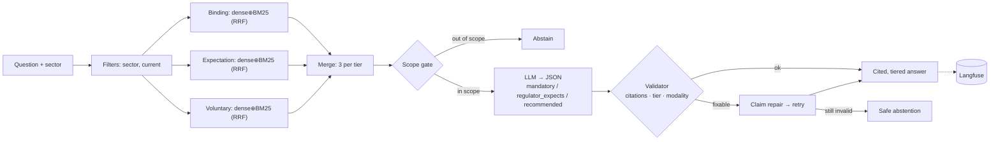

# AU AI Regulation Navigator

[](https://regnav-onlvzgx6fq-ts.a.run.app)

**Tier-aware RAG over Australian AI regulation, built to model-risk standards.**

Live demo: [https://regnav-onlvzgx6fq-ts.a.run.app](https://regnav-onlvzgx6fq-ts.a.run.app).
Not legal advice. Do not enter personal or customer information. Questions are logged to Langfuse.

Ask *"What do we need to do before engaging a third-party AI vendor?"* and get an answer split by
legal force, with every claim cited:

> **Mandatory** (binding standard)
> - Before entering into a material arrangement, an APRA-regulated entity must undertake appropriate due diligence… *[CPS 230 para 52]*
>
> **Regulator expects** (guidance, not itself enforceable)
> - Organisations should ensure they have enough information to understand how a commercially available AI product works… *[OAIC AI products guidance]*
>
> **Recommended** (voluntary guidance)
> - Ask the developer or supplier to show proof that the AI system has been properly tested… *[AI6 Foundations]*
>
> *Not legal advice.* · config `hybrid_stratified` · index `idx-2185d086e9c4`

## Why this is hard: the core idea

Australian AI regulation sits in tiers of different legal force:

| tier | documents in corpus | says "AI"? |
|---|---|---|
| **Binding** | APRA CPS 230 Operational Risk, CPS 234 Information Security, CPS 220 Risk Management | **No**: technology-neutral |
| **Regulator expectation** | APRA AI letter (Apr 2026), CPG 230, CPG 235, OAIC ADM transparency fact sheet (APP 1.7–1.9, from 10 Dec 2026), OAIC AI-products guidance | Sometimes |
| **Voluntary** | National AI Centre *Guidance for AI Adoption* (AI6) | In every sentence |

Naive RAG retrieves by similarity, so an "AI vendor" question pulls in AI-heavy voluntary guidance
and **misses the binding obligation**, because CPS 230 talks about "service providers", not AI.

**Fix:** tier metadata on every chunk, **hybrid retrieval (dense + BM25, RRF) run separately per
tier** with a quota, and answers structured as *Mandatory / Regulator expects / Recommended*,
enforced by a validator: a claim's section must match its source's tier, and "should" can never
become "must".

## Results

*Provisional: 40 DRAFT questions written by the developer; an expert-reviewed gold set is next.*

**Retrieval** (all three configs). Binding-source coverage is the share of the 23 questions whose
answer involves a binding standard where at least one binding chunk reached the model:

| config | binding coverage [95% CI] | recall@5 | MRR |
|---|---|---|---|
| dense, pooled (naive) | **0.48** [0.27, 0.68] | 0.52 | 0.70 |
| hybrid (dense + BM25), pooled | **0.61** [0.40, 0.80] | 0.55 | 0.77 |
| **hybrid, tier-stratified** | **1.00** [1.00, 1.00] | 0.58 | 0.63 |
| **+ query expansion + cross-encoder re-rank, 4/tier** (`hybrid_stratified_rerank`) | **1.00** | 0.62 | 0.76 |

Re-ranking fixes the next problem down: getting the *right paragraph* within each tier.
Context recall rises 0.61 → 0.74 and **binding gold-paragraph hit 0.65 → 0.91** (paired bootstrap
Δ +0.26 [+0.04, +0.48]); a budget-only control shows the gain isn't just from the larger context.
Details: [docs/retrieval_ablation.md](docs/retrieval_ablation.md).

**Generation** (tier-stratified; Qwen 27B generator, gpt-oss-120b judge): faithfulness **0.97**,
answer correctness 0.77, authority-label accuracy **1.00**, modality error rate **0.00**,
abstention precision/recall 1.00 / 0.80. The pooled-baseline generation runs are in progress (free-tier
quota). Answers are faithful but sometimes incomplete, because the key paragraph isn't always
retrieved; that is the next thing to improve.

These figures stay **provisional**. They are not measurements of the live demo.

Full table: **[docs/results.md](docs/results.md)** · validation write-up:
**[docs/VALIDATION_REPORT.md](docs/VALIDATION_REPORT.md)** · per-question outputs: `docs/eval_runs/`.

### Smoke check (not an evaluation)

Three questions on the live demo, 20 November 2026. This checks that the service answers, cites, and abstains. It does not update the provisional metrics above.

| Question | What the demo did | Time on screen |
|---|---|---|
| What CPS 230 requires before engaging a third-party AI vendor | Cited answer in all three tiers, including CPS 230 para 52 | 47.3 s (first answer; models were loading) |
| What APP 11 requires when AI handles personal information | Cited OAIC guidance and CPS 230 under Regulator expects and Recommended. The APP 11 statute is not indexed, so nothing was labelled Mandatory from that Act | 12.1 s |
| Whether the EU AI Act requires a conformity assessment for a credit model | Abstained. The scope gate said the EU is outside this Australian corpus. No model call | 11.7 s |

## Deployment

The live demo runs on Cloud Run in `australia-southeast1` and scales to zero. A cold start is about **1.5 minutes**. The first answer after that is slower, because the embedding model and the cross-encoder load on that request. The generator is Groq `qwen/qwen3.8-27b` only. There is no local fallback on the demo. If Groq fails, the app abstains.

Keys are in Secret Manager, not in the repo. Deploy is a manual GitHub Action (**Deploy Cloud Run**): keyless OIDC, `workflow_dispatch` only, so a push to `main` does not deploy. Rollback is the same workflow with the ref set to an older full commit SHA. A billing budget alert is set at **A$30**.

On the demo, a banner says this is not legal advice, asks you not to enter personal or customer information, and says questions are logged to Langfuse. A session is capped at 20 questions and 500 characters. The config cannot be switched. Details: [docs/DEPLOYMENT.md](docs/DEPLOYMENT.md).

## Architecture



More: [docs/ARCHITECTURE.md](docs/ARCHITECTURE.md) · [docs/DEPLOYMENT.md](docs/DEPLOYMENT.md) · decisions: [DECISIONS.md](DECISIONS.md) ·
tests: [docs/TEST_PLAN.md](docs/TEST_PLAN.md) · model card: [docs/MODEL_CARD.md](docs/MODEL_CARD.md).

## Quickstart

### Docker (app + MLflow UI)

```bash
cp .env.example .env
```

Put `GROQ_API_KEY` in `.env` (free key from console.groq.com); Langfuse keys are optional.

```bash
uv run python -m regnav.cli ingest
```

If you don't have `uv`, build the index inside the container instead:

```bash
docker compose run --rm app python -m regnav.cli ingest
```

```bash
docker compose up --build
```

* App: http://localhost:8501 (toggle **Offline demo** if you have no API key)
* MLflow: http://localhost:5000
* The containers run as your host user (`UID`/`GID`, default 1000) so they can write to the mounted
  `chroma/` and `mlruns/`. If your Linux UID isn't 1000, prefix the command with
  `UID=$(id -u) GID=$(id -g)`.
* Image: multi-stage build, CPU-only torch, embedding model baked in, non-root, healthcheck.
  The image also bakes `data/raw` and the Chroma index, and listens on `$PORT` (8501 if unset).
  Compose mounts `./data` and `./chroma` over those baked copies and sets `REGNAV_PUBLIC_DEMO=0`,
  so `docker compose up` still uses the host index from the ingest step above.
  Behind a TLS-inspecting corporate proxy:
  `docker build --secret id=ca_bundle,src=ca.pem --build-arg HTTPS_PROXY=... .`

Run the baked image the way Cloud Run will (no mounts, port 8080, guardrails on). In PowerShell:

```powershell
docker build -t au-ai-reg-navigator:latest --build-arg GIT_SHA=$(git rev-parse HEAD) .
docker run --rm -p 8080:8080 -e PORT=8080 -e REGNAV_UI_OFFLINE=1 au-ai-reg-navigator:latest
```

Then open http://localhost:8080. `REGNAV_UI_OFFLINE=1` skips Groq.

### Local fallback model (keeps working when Groq's free tier runs out)

The app and CLI use Groq first. When Groq's limits are hit (or it's down), answers come from
**Qwen3-4B running locally in Ollama**, and the screen says so: a 💻 **Local model** badge, an
amber "Fallback in use" banner with the reason, and the sidebar's **Model status**. After a
*daily* limit, the app stays on the local model until Groq's reported reset, instead of waiting
on a failing call every time. Evaluations never fall back, so config comparisons stay clean.

One-time setup on your laptop:

1. Install Ollama from **ollama.com/download** and start it.
2. Download the model (~2.5 GB):

```bash
ollama pull qwen3:4b
```

The Docker app reaches it automatically at `host.docker.internal:11434`. Local answers take about
1–3 minutes on a CPU-only laptop.

### Local (uv)

```bash
make install
```

```bash
make ingest
```

```bash
make ask Q="Who is accountable for AI risk?" SECTOR=insurer
```

```bash
make app
```

Fully offline on a laptop (Ollama, Qwen3-4B on CPU): `bash scripts/setup_local.sh`, then use
`configs/local_stratified.yaml`.

### Evaluate

| command | what |
|---|---|
| `make test` | unit + integration tests (no network, no key) |
| `make regression-gate` | retrieval gate on the fixture corpus (CI) |
| `make eval-retrieval` | retrieval metrics for all 3 configs (seconds, no LLM) |
| `make eval-all && make compare` | full eval on `data/eval/questions.jsonl` → MLflow + `docs/results.md` |
| `make eval-draft` | provisional eval on the 40 DRAFT questions |
| `make judge-calibration` | export 10 judged answers to label; run again for Cohen's κ |
| `make test-adversarial` | prompt injection, out-of-scope, legal advice, voluntary-only, not-yet-in-force |
| `make release-check CONFIG=configs/hybrid_stratified.yaml` | release gate (tests + gate + eval + thresholds + index version) |

## Engineering

* **Stack:** Python 3.12, uv (pinned `uv.lock`, CPU-only torch), PyMuPDF, Chroma, rank-bm25,
  sentence-transformers, Groq/Ollama/Anthropic behind one interface, Langfuse, MLflow, Streamlit.
* **Quality:** ruff, mypy, pytest with 167 hermetic tests and ~82% coverage, pre-commit, GitHub
  Actions CI (lint, types, tests, retrieval regression gate, Docker build).
* **Reproducibility:** content-addressed `index_version` covering source hashes, metadata,
  chunking, embedding and ingest code; fixed seeds; temperature 0; every answer and eval run tagged
  with config and index version.
* **Governance:** model card, Line-2-style validation report, release gate that blocks on
  unevaluated index changes or threshold breaches.

## What I'd do next

* **Parser comparison**: PyMuPDF vs Docling/Unstructured on the CPS PDFs, scored by chunk-boundary accuracy.
* **Embedding comparison and fine-tuning**: bge-small vs bge-large/e5/legal-domain models; fine-tune on (question, paragraph) pairs mined from CPGs that cite CPS paragraphs.
* ~~Cross-encoder re-ranking and AI→tech-neutral query expansion~~: **done** (`hybrid_stratified_rerank`, D-042). Next: a domain-tuned reranker, and LLM-free query expansion learned from CPG→CPS citations.
* **AI6 crosswalk**: map each AI6 practice to the CPS/CPG paragraphs that make it mandatory for APRA-regulated entities.
* **Long-context baseline**: put the whole current corpus (~200k tokens) in context and compare cost, latency and authority-label accuracy.
* **Scheduled ingestion** from the Federal Register of Legislation, with source-hash change → re-eval → release gate.
* **More sources**: Privacy Act / APP text (so APP 1.7–1.9 is labelled binding), ASIC guidance, SPS standards for super, and the proposed national AI standards as a fourth *Proposed* tier.
* **Online monitoring dashboard** from Langfuse: abstention, fallback and repair rates, latency and judge-scored samples over time, with alert thresholds.

---

*General information from public documents, not legal advice.*
