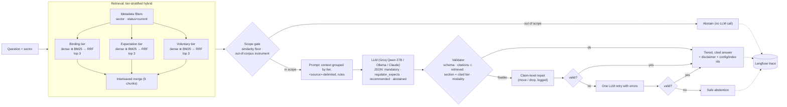
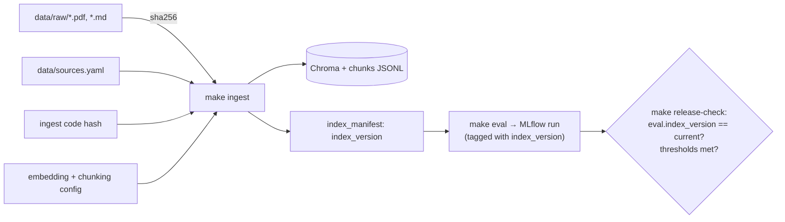

# Architecture

## The problem in one picture

Australian AI regulation sits in tiers of different legal force. The binding standards (APRA
CPS 230/234/220) are **technology-neutral**: they regulate *service providers*, *information
assets* and *operational risk*, and never say "AI". Voluntary guidance says "AI" in every
sentence. A naive RAG pipeline therefore answers "What must we do before engaging an AI vendor?"
from voluntary guidance and misses the binding obligation (CPS 230 para 52).

## Components

| layer | module | key choices |
|---|---|---|
| Source registry | `data/sources.yaml`, `regnav/ingest/load.py` | one entry per document: tier, `applies_to`, status, effective date, URL, parse hints; sha256 written by ingest |
| Parsing | `regnav/ingest/parse.py` | PyMuPDF `dict` output → logical lines; strips running headers/footers (repeated + in margin), footnotes (smaller font), page numbers, CPG 230 quote boxes; font-size/weight headings; visual re-ordering of lines; Markdown for saved web pages |
| Chunking | `regnav/ingest/chunk.py` | one chunk per numbered paragraph (or heading section); long paragraphs split at (a)/(b)/(c) **repeating the lead-in**; tiny units merged; `[Doc · Tier · Section · para N]` prefix; stable ids (`apra_cps230_2026:p52`); fixed-size 512/64 ablation |
| Tagging | `regnav/ingest/tag.py` | modality must/should/info by regex (negation-aware); flat scalar metadata (`applies_bank`…) for Chroma |
| Index | `regnav/ingest/index.py` | Chroma (cosine) + chunk JSONL for BM25; per-document fingerprint (file hash + metadata + **ingest-code hash**); incremental updates; content-derived `index_version` in `index_manifest_*.json` |
| Retrieval | `regnav/retrieve/` | dense (BGE-small, query instruction), BM25 (Okapi, light stemming), RRF fusion (k=60), tier-stratified wrapper; filters applied identically to both retrievers |
| Retrieval options | `regnav/retrieve/{expand,rerank,query,stages,plan}.py` | AI→tech-neutral query expansion and cross-encoder re-ranking (D-042); answer-format instruction stripping and a soft per-document cap in the guidance tiers (default since D-057, `hybrid_stratified_capped`); playbook stage sub-queries for broad questions (`data/playbooks.yaml`, opt-in in Q&A, always on in the model-use check) |
| Model-use check | `regnav/assess/`, `data/playbooks.yaml`, `data/use_cases/` | use-case intake → playbooks selected by its answers → each lifecycle stage searched per tier (2 binding, 2 expectation, 1 voluntary) → deduplicated checklist with per-tier relevance floors, applicability notes citing CPS 230 para 60 and the APP 1.7-1.9 commencement, Markdown + CSV; **no LLM**; stage results cached per index version (D-053) |
| Commencement dates | `regnav/commencement.py`, `data/commencements.yaml` | obligation-level start dates, each backed by verbatim quotes (live chunk to cite + the Act, staged); answers must state a pending date citing its source, or quote it; drives the model-use check note and ⏳ flags (D-056) |
| Coverage | `regnav/coverage.py`, `data/coverage.yaml` | names topics outside the library (Privacy Act text, FAR, CPS 510, ASIC, insurance and credit law, anti-discrimination, actuarial standards) on answers and checklists (D-054) |
| Generation | `regnav/generate/` | provider-agnostic LLM interface (Groq/OpenAI-compatible, Ollama, Anthropic, stub); scope gate; prompt v3; validator; claim-level repair; one retry; safe abstention |
| Observability | `regnav/observability/langfuse.py` | one trace per query: retrieval span (ids, tiers, scores), a generation per attempt (tokens, cost, latency, validation errors), config + index + prompt version; no-op without keys |
| Evaluation | `regnav/eval/` | retrieval metrics, rule-based generation metrics (final + raw), LLM judge, bootstrap CIs, MLflow, compare, judge calibration, regression gate, release check |
| UI | `app/streamlit_app.py` (navigation, demo password), `app/views/{home,model_use_check,ask}.py`; Home lists the document library from `data/sources*.yaml` via `regnav/library.py` | Ask page: config + sector selectors, tiered answer cards, sources panel with tier/modality badges, trace link, offline-stub mode. Model-use check page: intake form, examples, checklist by stage, CSV / Markdown download |

## Data flow and versioning

Anything that can change an answer (a source file, its metadata, the parser, the chunker, the
embedding model) changes the `index_version`. Every answer, trace and eval run carries it, and
the release gate refuses to approve a version that has not been fully re-evaluated.

## Guardrails

* **Document text is data**: `<source>` delimiters, any `<source` inside document text escaped,
  explicit system-prompt rule; validated by an adversarial injection test.
* **Authority cannot be inflated**: a claim's section must match the cited chunk's tier;
  "should" sources can never appear under `mandatory` or be paraphrased as "must".
* **Out-of-scope → abstain**: scope gate before the LLM; LLM instructed to abstain when no
  source is relevant; abstention precision/recall measured.
* **No unvalidated output**: repaired or safe-abstention fallback, never raw model text.
* **Secrets**: `.env` (gitignored, excluded from Docker context) or proxy-injected; never logged;
  `flat_params()` excludes anything key-like.
* **No PII**: the app collects none; only the question text is traced.
