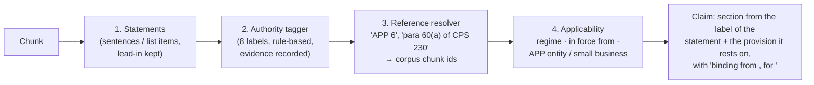

# Statement-level legal authority: design and labelling guide

**Status: built and staged offline; not yet live** (DECISIONS D-044). It switches on, with a new
index version and a fresh evaluation, after the in-flight four-config evaluation completes.
Staging results: [authority_staging_report.md](authority_staging_report.md).

## The problem

The answer sections (Mandatory / Regulator expects / Recommended) were assigned by **document**.
That is wrong in both directions, and often:

* **Guidance restating law** gets labelled optional. The trigger case: *"When does the APP 1.7–1.9
  obligation commence?"* was answered under *Regulator expects · not itself enforceable*, although
  APP 1.7–1.9 is binding Privacy Act law from 10 Dec 2026. In the OAIC AI-products guidance alone,
  47 of 68 chunks cite a binding provision.
* **Non-obligations inside binding standards** are labelled mandatory: "APRA may…", "need not
  comply…", definitions. There are 14 such chunks across CPS 220/230/234.
* **The regulator's view of the law** ("the OAIC considers…") is neither law nor a recommendation.

A compliance user's real question is: *do we have to do this, from when, or is it just recommended?*

## Design: four layers

1. **Statements** (`regnav/legal/statements.py`): one per sentence or list item. A list item inherits
   its lead-in ("An entity must:"), which carries the legal force.
2. **Tagger** (`regnav/legal/tagger.py`): rule-based and ordered, recording the evidence pattern
   behind every label. There is no LLM by default, so it is auditable and deterministic.
3. **Resolver** (`regnav/legal/references.py`, registry `data/legal_refs.yaml`): parses citations
   and links them to corpus chunks. When guidance restates law, the **provision** becomes the
   authority and the guidance its explanation. A reference to law outside the corpus is kept and
   flagged "not in corpus", never silently trusted.
4. **Applicability** (`regnav/legal/applicability.py`): who is bound, and from when.
   * *Privacy regime*: an "organisation" excludes a small business operator (s 6C(1)). A business
     with turnover of $3m or less is generally a small business operator (s 6D(1), (3)), **except**
     health service providers holding health information, businesses that trade in personal
     information, Commonwealth contracted service providers, credit reporting bodies (s 6D(4)),
     related bodies corporate of a larger business (s 6D(9)), or those that opt in (s 6EA). An
     unknown turnover gives "check", not a guess. APRA-regulated entities are *assumed* to be APP
     entities, with that assumption stated.
   * *Dates*: law enacted but not yet in force gives **"binding from <date>"** (APP 1.7: 10 Dec 2026).
     Superseded versions give "historical".
   * *Sector*: the prudential standards bind APRA-regulated entities only.

## The labels (for the labelling sheet)

| label | use when the statement… | example |
|---|---|---|
| `binding_requirement` | is an obligation in an Act or binding standard | "An APRA-regulated entity must maintain…" (CPS 230) |
| `binding_context` | is in an Act or binding standard but is **not** an obligation: definitions, powers ("APRA may"), carve-outs ("need not comply"), commencement, objectives | "APRA may require an entity to review its tolerance levels." |
| `restates_law` | is in **guidance** and states what the law or a standard requires | "This collection must comply with APP 3 and APP 5." (OAIC) |
| `regulator_interpretation` | is the regulator's view of what the law **means or covers** | "The OAIC considers ML outputs… would generally fall within scope." |
| `regulator_expectation` | is a supervisory expectation, recommendation or better practice from a regulator | "APRA expects information provided to the Board is targeted." |
| `voluntary_recommendation` | is a recommendation in voluntary government guidance | "Assign a senior leader as the overall AI governance owner." (AI6) |
| `information` | has no normative force: description, observation, example, citation | "AI adoption is accelerating across industries." |
| `unclear` | uses mandatory wording in guidance but you can't tell whether it states law | "You must implement controls to ensure outputs are accurate." |

Rules of thumb:
* Judge the statement **together with its lead-in** (the `lead_in` column).
* Use **`restates_law`** only if a reasonable compliance officer would read it as "the law requires
  this". If it's guidance phrased forcefully without a legal basis you can identify, use `unclear`.
* "APRA expects / envisages / a prudent entity would" is an expectation, not an interpretation.
* When genuinely torn between two labels, pick one and add a note in `notes`.

## How to label and score

1. Open `data/eval/clause_labels.csv` (150 statements, stratified across documents and labels).
   Fill in **`human_label`** with one of the 8 labels above. The tagger's predictions are in a
   separate file (`clause_tagger_predictions.jsonl`). **Don't open it before you finish**, so the
   predictions don't anchor your judgement.
2. Run `make clause-eval`. It reports accuracy, per-label precision and recall, Cohen's kappa
   (8 labels), and kappa for **binding vs not binding**, the distinction that matters most to users.
3. Proposed acceptance before switch-on: binding-vs-not kappa ≥ 0.8, `restates_law` recall ≥ 0.8.
   Misses become tagger rules or registry entries, followed by re-scoring on a fresh sample (to avoid
   tuning to the test set).

## What switch-on involves (after the in-flight eval)

1. Merge `data/sources_pending.yaml` into `data/sources.yaml` (APPs 1–13, APP 1.7–1.9, ss 6C–6EA).
   This gives a new `index_version`.
2. Store statement labels and resolved references with each chunk at ingest. This is an ingest-code
   change, recorded in the index version.
3. Retrieval: when a guidance chunk that restates law is retrieved, add the cited provision to the
   binding tier.
4. Answer schema: each claim carries `authority` (label) and, for restated law, `legal_basis` (the
   provision's chunk id). The validator checks section against the claim's authority, not the
   document tier. `unclear` produces "binding status unclear – check <provision>".
5. UI/CLI: a sector + "APP entity?" input (turnover over $3m, the s 6D(4) exceptions, opted in), and
   per-claim "binding from <date> · for APP entities" badges.
6. Re-run the full evaluation, including the 10 authority questions
   (`data/eval/questions_draft_authority.jsonl`), and the release gate.

## Known gaps

* **SPS 220** (risk management for super trustees, the counterpart of CPS 220) and APRA definition
  standards (APS/GPS/LPS/HPS 001) are cited but not in the corpus.
* Statutes are chunked by heading; long APPs split into parts whose lead-in is the sub-heading
  rather than the governing subclause (e.g. APP 3.3's "unless:"). Statement tagging uses the
  in-chunk lead-in, so labels are unaffected, but a subclause-aware chunker would improve citations.
* Section 6E (small business operators treated as organisations for specific activities, e.g.
  AML/CTF reporting entities) is cited but not modelled in the applicability rules.
