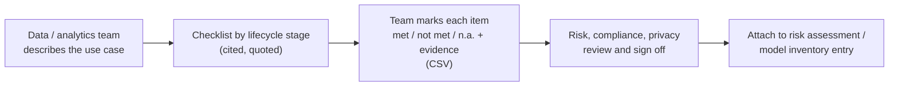

# Model-use check

**For data leads, data scientists, ML engineers, actuaries and analytics teams** at APRA-regulated
banks and insurers (D-051, D-053). Describe one model or AI use; get the requirements and
expectations to check, grouped by stage of the model lifecycle, each quoting its source paragraph.

* App: **Model-use check** page in the sidebar (`make app`).
* CLI: `make check USE_CASE=data/use_cases/motor_pricing_gbm.yaml` writes Markdown and CSV to
  `results/checks/`.
* Examples: [`docs/examples/model_use_check/`](examples/model_use_check/) (actuarial pricing model,
  LLM complaints assistant, in-house churn model).

It is a **starting point for the conversation with risk, compliance and privacy**, not a
compliance verdict. It never says a use case is compliant.

## Workflow

## The intake

| question | if yes (or unsure) the checklist adds |
|---|---|
| Personal information in training data, inputs, prompts or outputs? | Collection and use, overseas disclosure, security and retention, accuracy |
| Health, biometric or other sensitive information? | A consent note (APP 3) |
| Generative AI or an LLM? | What goes into prompts, output accuracy, telling people it's AI, AI-specific security |
| Makes or substantially informs decisions about people? | Privacy-policy disclosure of automated decisions (APP 1.7-1.9, with a countdown to 10 Dec 2026), fairness and bias testing, human oversight |
| External vendor, model API or platform? | Due diligence, contract terms, notifying APRA, vendor security, AI supply chain and exit |
| Data, models or staff offshore? | CPS 230 para 60(b): notify APRA before a material offshoring arrangement |
| Supports a critical operation? | CPS 230 para 60(a) notification; tolerance levels, BCP, incident notification |
| *(always)* | Model lifecycle: inventory and ownership, data quality, validation, monitoring and change; Board oversight |

"Unsure" counts as yes: the item is included and the answer is flagged for the team to confirm.
Sector (bank or insurer) and team (data science, actuarial, analytics...) select the *not covered*
pointers, for example insurance law for insurers' pricing and actuarial professional standards for
actuaries.

## How it works

1. The answers select **playbooks** (`data/playbooks.yaml`): reviewed, plain-text stage queries
   written in the regulators' technology-neutral vocabulary ("information assets managed by a third
   party", not "AI vendor"), each with the evidence teams typically produce and who usually signs off.
2. Each stage is searched **per tier**: up to 2 binding paragraphs, 2 regulator expectations and 1
   voluntary recommendation, using the same hybrid retrieval and cross-encoder as Q&A.
3. **Relevance floors** per tier drop off-topic matches and flag weak ones (below).
4. A paragraph found by several stages is listed once, under the first, with "also relevant to".
5. **Applicability notes** are deterministic sentences tied to the answers, each citing its
   paragraph (CPS 230 para 60(a)/(b); the APP 1.7-1.9 fact sheet).
6. **No language model is used.** Every item is a quotation, so the check costs no API quota, gives
   the same output every time, and every line can be traced to its source.

Stage search results are cached in memory and on disk (`chroma/stage_cache/`), keyed by index
version and retrieval settings: the first check after a new index takes about 2 minutes on CPU,
later checks are instant.

## Calibration (relevance floors and exclusions)

Floors are on the cross-encoder score (ms-marco MiniLM logits) and were set by reading every item
of the three example checklists:

| tier | weak below | drop below | why |
|---|---|---|---|
| binding | −1.0 | −3.5 | Binding paragraphs are terse; when they match they score high (CPS 230 para 52: 9.6, para 60: 9.2). Below −3.5 they were generic operational-risk paragraphs (CPS 230 paras 12, 24, 26) or definitions (CPS 234 para 12) returned for privacy stages, because no binding privacy text is live. |
| expectation | 0.0 | −4.0 | Guidance matches mostly score 0–9; the few below 0 were tangential. |
| voluntary | −4.0 | −7.0 | AI6's long, discursive text scores low even when relevant (practice 5 "Test and monitor": −5.7), so the floor is lower and such items are flagged, not dropped. |

**Exclusions** (`exclude` in a playbook stage) remove paragraphs reviewed as misleading for that
stage. Currently one: CPS 230 para 27 (risk assessment before an entity *provides* a material
service to others) from vendor due diligence, which it resembles closely.

**Query vocabulary matters.** The generative-AI security stage first found no binding paragraph,
because its query used AI words only. Adding CPS 234's own wording ("information security controls
to protect information assets commensurate with threats") surfaced CPS 234 para 21. The same
principle as query expansion in Q&A: binding standards never say "AI".

## Testing

* Unit (`tests/unit/test_assess.py`): intake, playbook selection, notes (including the countdown
  switching tense after 10 Dec 2026), deduplication, floors, caching, Markdown and CSV, coverage.
* Corpus (`make test-corpus`, needs the real index): each example use case must surface the
  provisions a reviewer would expect (e.g. the pricing model must include CPS 230 paras 52, 53/54
  and 60, CPS 234 para 16/22, the APP 1.7-1.9 fact sheet, CPG 235, the APRA AI letter and the
  critical-operations paragraphs), and the in-house churn model must **not** include vendor rules.

## Known limitations

* **Privacy obligations appear under "Regulator expects"** with an "explains binding law" note,
  because the Privacy Act's text is staged but not live (D-044). Stages on personal information say
  so explicitly. Statement-level authority will move them to Mandatory.
* **Some binding items are context, not obligations**, e.g. CPS 234's objectives paragraph. The
  statement-level labels (D-044) will distinguish these.
* **Coverage depends on the playbooks.** A risk that no stage asks about will not appear. The
  playbooks are short and reviewable on purpose; additions should be reviewed like code.
* **Not a materiality assessment.** Whether a vendor arrangement is *material* or an operation
  *critical* is the entity's judgement; the checklist only shows what follows if it is.
* The expected-provision lists in the corpus test were written by the developer (DRAFT), like the
  evaluation questions.
